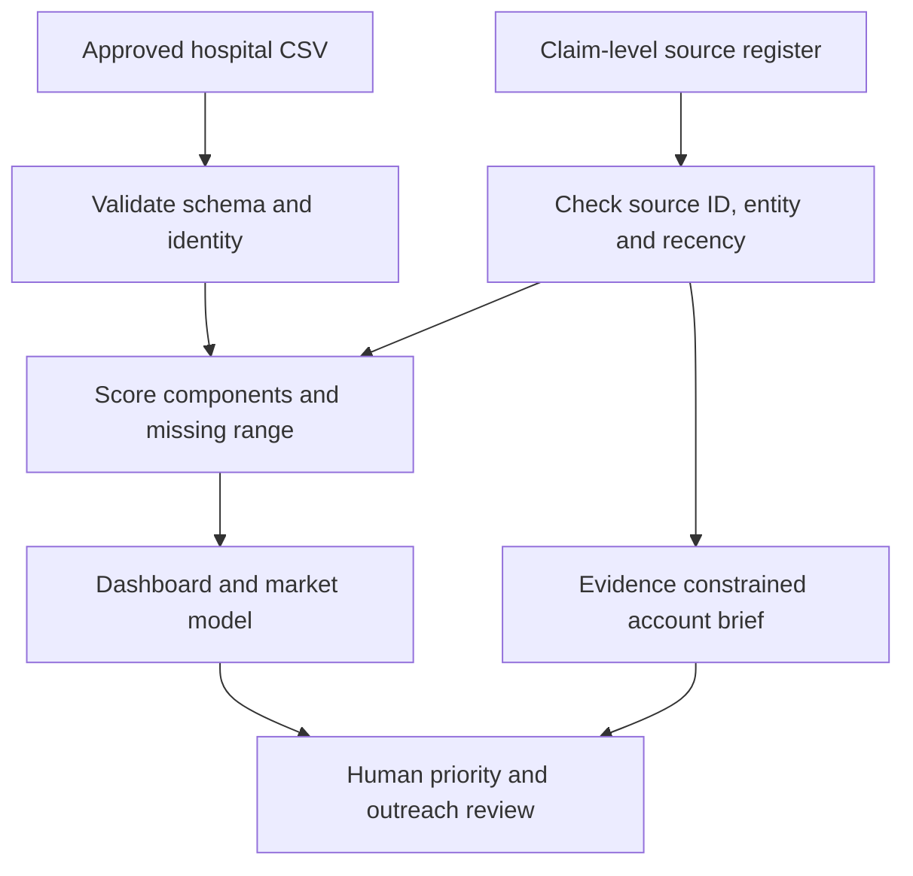

# Medisurge Market & Operations Intelligence

**An interactive, public-safe decision prototype for Medisurge Inc.** It helps a business owner test which hospital accounts deserve research, why they rank there, how missing evidence affects that decision, and how market assumptions change a potential opportunity range.

> **Demo data warning:** All 180 hospitals, ratings, pipeline stages and monetary inputs are fictional or hypothetical. This repository contains no real client leads, verified hospital universe, achieved savings or Medisurge revenue. Stakeholder validation and a private data-governance review are required before operational use.

## The business decision

Medisurge considers CSSD/sterilisation consultancy, NABH readiness and modular OT opportunities. Account selection is hard when locations, signals, service fit, research effort and evidence quality vary. This application makes the decision process inspectable: **which account should be researched next, for which service, with what support and what missing information?**

This is the planned **P2 Medisurge Market & Operations Intelligence** flagship project. The separate company brochure/catalogue website at [medisurgeinc.com](https://medisurgeinc.com) is a different deliverable.

## Start in VS Code (Windows PowerShell)

1. Extract the ZIP and open the `medisurge-market-ops` folder in VS Code.
2. Open **Terminal → New Terminal** and paste:

   ```powershell
   py -3.11 -m venv .venv
   .\.venv\Scripts\python.exe -m pip install -r requirements.txt
   .\.venv\Scripts\python.exe -m streamlit run app.py
   ```

3. Open the localhost URL displayed in the terminal. Python 3.11 or newer is recommended.

Mac/Linux:

```bash
python3 -m venv .venv
.venv/bin/python -m pip install -r requirements.txt
.venv/bin/python -m streamlit run app.py
```

**No API key or database is needed for the demo.** The CSV loads from `public_data/` at startup; the public viewer disables CSV uploads. For approved local testing only, set `MEDISURGE_PRIVATE_UPLOAD=1` before starting the app. Uploaded data is kept in the running session, without a persistent store. The included SQL is a future private PostgreSQL design, not a hidden prerequisite.

## Five-minute demonstration

1. **Overview:** filter geography and service line. Show the synthetic account mix, scenario high-priority count, research-first count and pipeline stage mix.
2. **Account priorities:** switch Balanced to Expansion led. Edit a weight and keep the six values totaling 100. Show the score floor/ceiling and each criterion's reason.
3. **Market scenarios:** change serviceability or annual capacity. Walk through TAM, SAM and capacity-limited SOM; the values are hypotheses, not realised Medisurge sales.
4. **Evidence & briefs:** open a fictional account. No fact is asserted because there are no verified sources. Show the labelled service-fit inference and research gaps.
5. **Excel + deck:** open [`excel/medisurge_market_model.xlsx`](excel/medisurge_market_model.xlsx) and the [10-slide review](docs/Medisurge_Opportunity_Review_v2.pptx). Change a blue input in Excel and show how the results recalculate.

## Decision logic

| Criterion | Balanced weight | Expansion led | Serviceability led |
| --- | ---: | ---: | ---: |
| Expansion | 25 | 35 | 15 |
| Surgical intensity | 20 | 20 | 15 |
| Service fit | 15 | 15 | 15 |
| Serviceability | 15 | 10 | 30 |
| Quality | 10 | 10 | 10 |
| Strategic account fit | 15 | 10 | 15 |

Each rating is 0–5. `score floor = Σ(known rating × weight ÷ 5)`; `score ceiling = score floor + total weight of missing ratings`. A score cannot silently treat an unknown factor as zero. The account goes to **Research first** if weighted rating coverage is below 80%, or a real account's evidence is unverified, stale, or lacks approved source claims. For otherwise eligible accounts, High starts at 72 and Medium at 52. Thresholds and weights are illustrative hypotheses, not approved policy.

`TAM = account universe × service applicability × illustrative project value`; `SAM = TAM × serviceable share`; `SOM = min(serviceable accounts × capture share, annual delivery capacity) × value`. All inputs are editable. For the shipped base example: 1,200 × 45% × ₹12 lakh = ₹6,480 lakh TAM; 35% of that = ₹2,268 lakh SAM; a 14-project capacity cap yields ₹168 lakh SOM. **These are scenario arithmetic, not a Medisurge market estimate or forecast.**

## Evidence and data flow



The public `source_register.csv` is intentionally empty. For real research, use [the source protocol](evidence/source_protocol.md) and record exact official or authoritative URLs, atomic claims, checked dates and human verification. An unverified statement cannot enter the **Facts** section of the brief. The brief is deterministic; this release **does not call an LLM** and does not claim an AI evaluation result. [The evaluation plan](evidence/ai_evaluation.md) explains the release gate for any later optional AI layer.

## Repository map

| Path | Purpose |
| --- | --- |
| `app.py` | Interactive Streamlit decision viewer |
| `src/engine.py` | Auditable ingestion, scoring, uncertainty, market model, source checks and brief |
| `public_data/` | Fictional cohort and empty source register |
| `scripts/generate_demo.py` | Seeded demo data generator |
| `excel/` | Editable formula-based decision workbook |
| `sql/` | PostgreSQL schema and analysis queries for an approved private build |
| `docs/` | Review deck, decision memo, privacy and release boundary |
| `evidence/` | Source protocol, stakeholder questions, feedback status and decision log |
| `tests/` | Meaningful checks for uncertainty, math, evidence and invalid uploads |

To regenerate the public demo and run checks from the repository root:

```bash
python -m scripts.generate_demo
python -m unittest discover -s tests -v
python -m scripts.check_release
```

The distributed Excel workbook and deck reflect the **shipped fixed seed**. If you regenerate data after changing the generator, rebuild those artifacts before presenting them together.

## Upload to GitHub

Create a new empty public repository named `medisurge-market-ops-intelligence` under your `sukhdev31` GitHub account. From the extracted project folder run:

```bash
git init
git add .
git commit -m "Build Medisurge market intelligence public demo"
git branch -M main
git remote add origin https://github.com/sukhdev31/medisurge-market-ops-intelligence.git
git push -u origin main
```

Before pushing, run `python -m scripts.check_release` and look at `git status`. The `.gitignore` excludes local secrets, private working data and database files. **Do not add real customer or hospital contact details to the public repository.**

## Deploy the public demo

On [Streamlit Community Cloud](https://share.streamlit.io/), connect the GitHub repository, choose `main`, set the entrypoint to `app.py`, and deploy. `requirements.txt` at the repository root supplies the app dependencies. No secrets are required. Add your actual public app URL here after the first deployment.

The public service is a **read-only viewer with uploads disabled**, not a multiuser CRM. A real business deployment requires approved data, authentication, access logs, private persistence, retention, backups, a security review and owner sign-off. The local demonstration can be run immediately; a hosted URL cannot exist until the repository is pushed and deployed by an account owner.

## What is complete and what remains to validate

| Deliverable | Status |
| --- | --- |
| Working public app; filters; editable weights; market scenarios; source constrained briefs | Implemented |
| Seeded 180-account synthetic cohort; deterministic tests; release check | Implemented |
| Editable Excel scenario model and review deck | Implemented |
| Source register, SQL design, privacy and decision logs | Implemented |
| Current verified hospital universe, competitor comparison, real stakeholder feedback | Pending real research and permission |
| Optional LLM assistant and frozen 50-case evaluation | Pending verified source corpus |
| Observed Medisurge research-time improvement, conversion or ROI | Pending controlled pilot |
| Live hosted URL and `.pbix` Power BI file | Not created in this package |

See [the decision memo](docs/recommendation.md) for the proposed 30/60/90-day pilot. The workbook, Streamlit dashboard and deck are ready for a portfolio demonstration; real operating claims are gated on real evidence.

## License

Code and fictional data are released under the MIT License. The Medisurge company name is used here to describe the user’s project; no logo, trademark rights or endorsement are granted by this repository.
